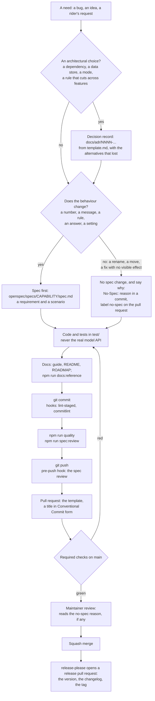

# Contributing

## What helps most

agentMotoride is open source (MIT) and stands on open data. Small
contributions make the biggest difference, roughly in this order:

1. **Speed defaults for your country.** Where OpenStreetMap has no limit on a
   road, the planner uses the country's legal default (`RURAL_DEFAULT_KMH` in
   `src/tools/trip.ts`, 25 countries and regions today). A missing or wrong
   one skews riding times and the open-road share. Add it with its source
   (the highway code); a "Country rules" issue is enough if you do not code.
2. **Fixes in OpenStreetMap.** A missing speed limit, a camera not mapped,
   wrong opening hours: fix it at [openstreetmap.org](https://www.openstreetmap.org).
   Every plan, and every other app on OpenStreetMap, gets better.
3. **An eval case.** A rider request the agent gets wrong, with what a right
   answer must do (`evals/cases.ts`, graded by code). Recording a case costs
   API money, so the maintainer records it; the case itself is the
   contribution ("Eval case" issue).
4. **A bug report with its trace.** `npm run rides -- runs` and `trace <id>`
   show what a session did; that is what makes a bug fixable.
5. **A data source**: another traffic provider, a map background for the ride
   picture, a region's open data. See `ROADMAP.md`.

Everyone taking part follows the [code of conduct](CODE_OF_CONDUCT.md).

## Setup

```bash
nvm use                 # Node 24, from .nvmrc
npm install             # also installs the git hooks (simple-git-hooks)
cp .env.example .env
npm run check           # environment and data services
```

With [Nix](https://nixos.org) (optional), `nix develop` (or `direnv allow`) gives
the same Node 24 plus `gh`, `jq` and `sqlite`, in place of `nvm use`.
`nix run .#quality`, `.#eval`, `.#smoke` and `.#mcp-smoke` run the matching
npm scripts, and `nix flake check` lints the Nix files. Each file in
`nix/modules/` is a self-contained flake-parts module, picked up automatically.

## Workflow

The path every feature follows, from the need to the release. `docs/EVOLVING.md` explains each step; this page is the map.



### What do I do for my change?

| Your change                                                                | Do                                                                                                          |
| -------------------------------------------------------------------------- | ----------------------------------------------------------------------------------------------------------- |
| New behaviour, or a changed number, message, rule, answer or setting       | Edit the spec of the capability: a requirement and a scenario. Same pull request, committed first.          |
| A new capability                                                           | A new folder under `openspec/specs/`, a line in `openspec/README.md`, an entry in `openspec/code-map.json`. |
| A new source file                                                          | Add it to `openspec/code-map.json`, so a change to it is tied to its spec (the review warns if not).        |
| An architectural choice                                                    | A decision record in `docs/adr/`.                                                                           |
| A feature over several pull requests, or a design to agree before any code | A proposal in `openspec/changes/`: `openspec/README.md`.                                                    |
| A rename, a move, formatting, a fix with no visible effect                 | No spec change. A `No-Spec: <reason>` line in a commit, and the `no-spec` label on the pull request.        |
| The guide, the README or the roadmap only (no change under `src/`)         | Nothing more to do.                                                                                         |

Two things that are **not** a spec change: a change to the docs, and a spec edit that only moves whitespace. And do not
reach for `no-spec` when a test needed a new case or a number or a message changed: the review warns about it, and the
reviewer reads your reason. When unsure, update the spec.

### What is checked, where, and can it be skipped

| When         | What runs                                                                                               | Skippable?                                                                             |
| ------------ | ------------------------------------------------------------------------------------------------------- | -------------------------------------------------------------------------------------- |
| `git commit` | pre-commit: ESLint and Prettier on the staged files. commit-msg: Conventional Commits.                  | `--no-verify`                                                                          |
| `git push`   | pre-push: `npm run spec:review` (see below).                                                            | `--no-verify`, `SKIP_SPEC_REVIEW=1`, or no `npm install` yet (no hook)                 |
| Pull request | CI: typecheck, lint, format, tests, `openspec validate`, the PR title, and the spec review of the diff. | **No.** Four are required checks on `main`; only an administrator can merge past them. |
| Merge        | Nothing else: GitHub merges when the required checks are green. A person reads the pull request.        | Administrators                                                                         |

The hook and the CI job run the same deterministic review: the specs validate, a change under `src/` comes with a change to
the spec of what it touches (or a stated reason), and the records and spec paths a change cites exist. In CI the
justification is the **label**, set by a person; a commit line counts only locally. The verdict is the CI job's status,
green or red. Warnings are shown on the files and in the job summary and never turn it red.

### The local model is optional

`SPEC_REVIEW_MODEL=gemma4:12b` in your `.env` (with [Ollama](https://ollama.com) running) adds a review by a local model to
the hook: it looks for a requirement the code contradicts, and for a "no behaviour change" that is not true. It is free,
runs on your machine, and never edits anything. **Without it nothing is refused**: the hook says
`model review: Not requested` (or `NOT RUN, unavailable` when Ollama is configured but not answering) and the push goes
through if the deterministic checks pass. Details: `docs/EVOLVING.md`.

To show on your pull request that the model ran, push, then `npm run spec:review -- --provider ollama --publish`: it
posts a status on the commit (green or red, with the model's name) and one comment with the report, and only when the
review completed. A commit without that status is a commit the model has not reviewed. It is informational, not a
required check.

Reviewers can run the same on someone else's pull request, a fork's included:
`gh pr checkout 123`, then `npm run spec:review -- --base origin/main --provider ollama --model gemma4:12b`.
To clean up a repository rather than check a change: `npm run spec:review -- --audit`.

### In steps

1. Branch from `main`: `feat/...`, `fix/...`, `docs/...`, `chore/...`.
2. Decide as the chart shows: a decision record, a spec, or a reason for none.
3. Code with tests. Deterministic parts get unit tests under `test/`; the planner loop is tested against the fake services
   in `test/helpers/`. Never let a test reach the real model API.
4. `npm run quality` must pass (typecheck, lint, format check, tests with coverage thresholds).
5. Commit with Conventional Commits, one concern per commit, in the order of the chart (decision record, spec, code,
   tests, docs).
6. Open a pull request with the template filled in: the spec touched, what was verified, what was not. The **PR title
   follows the commit convention too**: a squash merge turns it into the commit on `main`, which release automation
   reads. If the change has no behaviour change, add the `no-spec` label and give the reason in the description.

## Commits

Conventional Commits, enforced by the commit-msg hook and in CI:

```
<type>(<scope>): <subject>

<body: what and why, wrapped at 120 columns, optional>

<footer: BREAKING CHANGE: ..., Refs #12, optional>
```

### Types

| Type       | Use for                                                | Release effect                 |
| ---------- | ------------------------------------------------------ | ------------------------------ |
| `feat`     | A capability the rider or an agent did not have before | minor version                  |
| `fix`      | Wrong behaviour corrected                              | patch version                  |
| `perf`     | Same behaviour, faster or cheaper                      | patch version                  |
| `refactor` | Code change with no behaviour change                   | none                           |
| `docs`     | Guide, README, specs, roadmap, comments                | none (listed in the changelog) |
| `test`     | Tests only                                             | none                           |
| `build`    | Dependencies, tooling, scripts, package.json           | none (listed in the changelog) |
| `ci`       | GitHub Actions, Dependabot, release automation         | none                           |
| `chore`    | Housekeeping that fits nowhere else                    | none                           |
| `style`    | Formatting, no logic change                            | none                           |
| `revert`   | Reverts a previous commit; subject names it            | depends on what is reverted    |

A breaking change adds `!` after the scope, `feat(mcp)!: ...`, and a
`BREAKING CHANGE:` footer explaining the migration. Before 1.0 it bumps the
minor version, after 1.0 the major.

### Scopes

Lower-case, kebab-case, the area touched. Common ones:

`planner`, `scouts`, `tools`, `routing`, `roads`, `weather`, `stops`,
`cameras`, `rides` (the library), `export` (GPX, Markdown), `share`, `cli`,
`mcp`, `codex`, `trace`, `runs`, `store`, `profile`, `deps`, `release`.

A scope is optional for changes that span the project (`docs: ...`,
`build: ...`).

### Subject and body

- Imperative, present tense: "add", "fix", "remove", not "added" or "adds".
- No trailing period, at most 100 characters for the whole header.
- Body when the why is not obvious from the diff: what changed, why, what was
  verified. Reference issues in the footer: `Refs #12`, `Closes #12`.
- One concern per commit. A PR with a feature, its tests and its docs is three
  commits, or one `feat` commit when they are inseparable.

### Examples

```
feat(stops): prefer places open at arrival
fix(mcp): route ride requests to the tools, not the shell
perf(roads): chunk Overpass queries along the route
refactor(tools): share tool definitions between the runner and the MCP server
docs(codex): remote connections from the ChatGPT app
test(maps): split links at a planned stop
build(deps): TypeScript 7 native compiler next to the TypeScript 6 API
ci: format check in the quality job
chore: remove scratch exports
revert: "feat(stops): prefer places open at arrival"
```

No attribution trailers or generated-by footers in commits or pull requests.

## Licence of contributions

Contributions are accepted under the project's MIT licence; by opening a pull
request you agree to it. Data contributions (speed defaults) cite their
source; never paste data from a source whose licence does not allow it.

## Releases

Release automation (release-please) opens and maintains a release pull request
on `main` with the changelog and version bump. Merging it tags the release and
publishes GitHub release notes. Nothing is published to npm.

## Code conventions

- Tools are plain async functions in `src/tools/`; schemas and descriptions
  live in `src/tools/index.ts` and are shared by the API runner and the MCP
  server.
- Rider rules are enforced in code, not left to the model.
- The MCP server logs to stderr only; stdout carries the protocol.
- Public map services: serialise, chunk, cache, and surface failures.
- Lint: ESLint with typescript-eslint, `eslint.config.js`. Format: Prettier,
  `.prettierrc.json`. Both pure JavaScript, no platform-specific binaries.
- TypeScript, two packages on purpose: `@typescript/native` is TypeScript 7,
  the native compiler behind `tsc` and `npm run typecheck`; `typescript` is an
  alias of `@typescript/typescript6`, the last version with a JavaScript API,
  which typescript-eslint and editors import. This is the layout the
  TypeScript 7 announcement recommends. Both are bumped by Dependabot
  independently.
